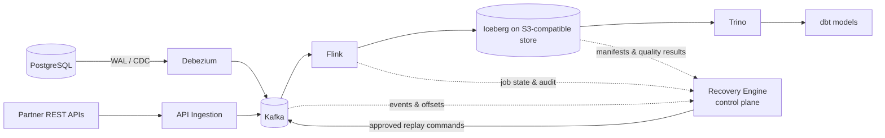

# Aether Data Platform

[](LICENSE)

**Aether** is a portfolio-grade distributed data reliability platform for e-commerce. It moves change data and business events from operational systems to an analytical lakehouse, while making correctness, replay, and reconciliation first-class concerns.

The project is deliberately designed as an engineering showcase rather than a thin integration demo. It explores the decisions and failure modes a Senior Data Engineer or Data Platform Engineer is expected to reason about: delivery semantics, data contracts, schema evolution, recoverability, observability, and operational ownership.

> **Status:** the first vertical slice runs end to end. `PostgreSQL -> Debezium -> Kafka -> Flink SQL -> Iceberg -> S3-compatible object store` is implemented, starts from a clean clone, and commits real snapshots with EXACTLY_ONCE checkpointing. Verified locally on 2026-10-26: job `RUNNING`, checkpoint 1 committed as snapshot `9046756570855116756` with 3 records. The recovery control plane, reconciliation, Trino and dbt layers are still design-only. See [local development](docs/local-development.md).

## Why Aether

Analytics systems frequently report numbers that look plausible even when they are incomplete, duplicated, or derived from incompatible schemas. Aether addresses that gap with four capabilities:

- Low-latency ingestion of PostgreSQL changes through Debezium and Kafka.
- Stateful streaming transformations in Flink, written to Apache Iceberg tables.
- A separate recovery control plane for replay, deduplication, incident tracking, and reconciliation.
- Explicit data contracts and observable quality checks between every major boundary.

The first domain is e-commerce: orders, payments, inventory, and customers. The design is intentionally transferable to other transactional domains.

## Target architecture



The solid path is the **data plane**. The dashed path is the **control plane**: it observes, governs, and requests recovery actions without becoming a data-path dependency. See [the architecture](docs/architecture.md) for boundaries, delivery guarantees, and trade-offs.

## Core scenarios

- **Real-time commerce analytics** — build trusted order, payment, and inventory views close to event time.
- **Failure recovery** — resume from checkpoints and execute a scoped, auditable replay after a processing or downstream failure.
- **Historical reprocessing** — rebuild a derived data product from a selected source range and versioned transformation.
- **Reconciliation** — compare source, Kafka, and Iceberg counts/keys to expose missing, duplicated, or late data.
- **Schema evolution** — validate producer changes against versioned contracts before they silently corrupt downstream datasets.

Two verification scripts prove the slice, and both are repeatable rather than demonstrative. `make verify-cdc` registers the connector, inserts a new order, and passes only when that order's unique reference appears in Kafka. `make verify-stream` reports cluster slots, per-job checkpoint counts, full exception stacks, topic offsets, the warehouse bucket, and the catalog rows the writer recorded, so a job that is merely `RUNNING` cannot be mistaken for a pipeline that commits.

Detailed acceptance scenarios are in [docs/use-cases.md](docs/use-cases.md).

## Technology choices

| Concern | Technology | Why |
|---|---|---|
| Transactional source | PostgreSQL | Realistic relational source with WAL-based CDC |
| CDC | Debezium | Preserves database changes and source metadata |
| Event transport | Apache Kafka | Durable, replayable ordered partitions |
| Stream compute | Apache Flink (SQL) | Stateful processing and checkpoint-based recovery |
| Lakehouse storage | Apache Iceberg + SeaweedFS (S3) | ACID tables, snapshots, schema evolution, time travel |
| SQL / semantic transformations | Trino + dbt | Interactive federation and governed analytics models |
| Orchestration | Airflow (design only) | Scheduling, backfills, and operational dependencies |
| Reliability services | Recovery Engine (design only) | Reconciliation, replay governance, and incident audit |

The rationale for the foundational choices is recorded in [ADRs](docs/adr/).

## Repository map

```text
.
├── docs/                 # Product, architecture, and decision records
│   ├── adr/              # Immutable architecture decision records
│   └── diagrams/         # Source-controlled diagrams when added
├── infra/docker/         # Docker Compose, connector config, Flink library lock
├── services/
│   ├── ingestion/        # API ingestion adapters
│   ├── streaming/        # Flink SQL pipeline, image, and runtime scripts
│   └── recovery/         # Recovery Engine control-plane service
├── dbt/models/           # Analytics transformations and tests
├── orchestration/        # Airflow DAGs and deployment configuration
├── scripts/              # Repeatable local setup and verification commands
├── tests/docs/           # Documentation-specific test fixtures or checks
└── .github/workflows/    # CI quality gates
```

Empty directories are intentional placeholders for the next phase. They describe ownership boundaries before code arrives.

## Getting started

```bash
git clone https://github.com/AndrewLhn/aether-data-platform.git
cd aether-data-platform
make setup         # development dependencies (PyYAML) for the local checks
make libs          # download the pinned Flink libraries and verify their SHA-512
make up            # postgres, kafka, connect, seaweedfs, flink
make verify-cdc    # PostgreSQL -> Kafka, proven with a freshly inserted order
make pipeline      # submit the Kafka -> Iceberg streaming job
make verify-stream # job state, checkpoints, exceptions, warehouse contents
```

`make help` lists every target. Roughly 2.5 GB of images on first pull and 165 MB of libraries; see the [local development guide](docs/local-development.md) for prerequisites, endpoints, and troubleshooting.

`.env` is generated from `.env.example` by `make env`, which every Docker target depends on. It keeps values already set, adds keys the template introduced, and preserves local-only keys, so an environment file that predates a change is repaired instead of failing later with a missing-variable error. It holds local-only values, must never contain production credentials, and is ignored by Git.

## Engineering practices worth naming

A few decisions are load-bearing rather than stylistic, and each exists because of a specific failure:

- **Dependencies are declared, not vendored.** `infra/docker/flink/libs.lock` pins artifact, target and SHA-512. Digests are verified before use and the lock file is validated structurally before anything is downloaded, because a hand-transcribed digest once reached the repository one character too long.
- **The runtime floor is measured, not remembered.** `make verify-java` reads the class file major version out of every pinned JAR, handles multi-release entries correctly, and compares the result against the base image. Iceberg moving its baseline to JDK 17 is exactly the kind of change that otherwise surfaces as a stack trace four frames below the reported error.
- **Portability is checked, not assumed.** `docker compose config` happily resolves an absolute build context that exists only on one laptop. `make lint` fails on any host path that is not repository-relative, and on any variable the compose file interpolates but `.env.example` never declares.
- **Diagnostics do not truncate.** `make doctor` and `make verify-stream` print full exception stacks with secrets redacted. Two wrong diagnoses in this repository came from reading a stack trace that had been cut before the frame that mattered.

## Design documents

- [Use cases](docs/use-cases.md)
- [Functional and non-functional requirements](docs/requirements.md)
- [Architecture](docs/architecture.md)
- [Local development](docs/local-development.md)
- [ADR index](docs/adr/README.md)

## Delivery principles

1. Correctness has a visible evidence trail: lineage, offsets, checkpoint IDs, and reconciliation results are recorded.
2. At-least-once transport is acceptable only where idempotent or transactional sinks make the business result safe.
3. Recovery is a controlled operation, never an opaque retry loop.
4. The data plane remains available when the control plane is impaired.
5. Each incremental phase must be demonstrable locally and repeatable in CI.

## License

This project is licensed under the [MIT License](LICENSE).
