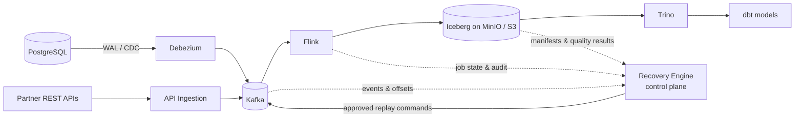

# Aether Data Platform

[](LICENSE)

**Aether** is a portfolio-grade distributed data reliability platform for e-commerce. It moves change data and business events from operational systems to an analytical lakehouse, while making correctness, replay, and reconciliation first-class concerns.

The project is deliberately designed as an engineering showcase rather than a thin integration demo. It explores the decisions and failure modes a Senior Data Engineer or Data Platform Engineer is expected to reason about: delivery semantics, data contracts, schema evolution, recoverability, observability, and operational ownership.

> **Status:** architecture and design baseline. The repository currently contains the agreed target design and local-development scaffolding; runnable infrastructure and pipelines are the next phase.

## Why Aether

Analytics systems frequently report numbers that look plausible even when they are incomplete, duplicated, or derived from incompatible schemas. Aether addresses that gap with four capabilities:

- Low-latency ingestion of PostgreSQL changes through Debezium and Kafka.
- Stateful streaming transformations in Flink, written to Apache Iceberg tables.
- A separate recovery control plane for replay, deduplication, incident tracking, and reconciliation.
- Explicit data contracts and observable quality checks between every major boundary.

The first domain is e-commerce: orders, payments, inventory, and customers. The design is intentionally transferable to other transactional domains.

## Target architecture



The solid path is the **data plane**. The dashed path is the **control plane**: it observes, governs, and requests recovery actions without becoming a data-path dependency. See [the architecture](docs/architecture.md) for boundaries, delivery guarantees, and trade-offs.

## Core scenarios

- **Real-time commerce analytics** — build trusted order, payment, and inventory views close to event time.
- **Failure recovery** — resume from checkpoints and execute a scoped, auditable replay after a processing or downstream failure.
- **Historical reprocessing** — rebuild a derived data product from a selected source range and versioned transformation.
- **Reconciliation** — compare source, Kafka, and Iceberg counts/keys to expose missing, duplicated, or late data.
- **Schema evolution** — validate producer changes against versioned contracts before they silently corrupt downstream datasets.

Detailed acceptance scenarios are in [docs/use-cases.md](docs/use-cases.md).

## Technology choices

| Concern | Planned technology | Why |
|---|---|---|
| Transactional source | PostgreSQL | Realistic relational source with WAL-based CDC |
| CDC | Debezium | Preserves database changes and source metadata |
| Event transport | Apache Kafka | Durable, replayable ordered partitions |
| Stream compute | Apache Flink | Stateful processing and checkpoint-based recovery |
| Lakehouse storage | Apache Iceberg + MinIO/S3 | ACID tables, snapshots, schema evolution, time travel |
| SQL / semantic transformations | Trino + dbt | Interactive federation and governed analytics models |
| Orchestration | Airflow (planned) | Scheduling, backfills, and operational dependencies |
| Reliability services | Recovery Engine (custom) | Reconciliation, replay governance, and incident audit |

The rationale for the foundational choices is recorded in [ADRs](docs/adr/).

## Repository map

```text
.
├── docs/                 # Product, architecture, and decision records
│   ├── adr/              # Immutable architecture decision records
│   └── diagrams/         # Source-controlled diagrams when added
├── infra/docker/         # Local Docker Compose and component configuration
├── services/
│   ├── ingestion/        # API ingestion adapters
│   ├── streaming/        # Flink jobs and event contracts
│   └── recovery/         # Recovery Engine control-plane service
├── dbt/models/           # Analytics transformations and tests
├── orchestration/        # Airflow DAGs and deployment configuration
├── tests/docs/           # Documentation-specific test fixtures or checks
└── .github/workflows/    # CI quality gates
```

Empty directories are intentional placeholders for the next implementation phase. They describe ownership boundaries before code arrives.

## Getting started

The local development stack provides PostgreSQL, Kafka, Kafka Connect, and MinIO for the first infrastructure phase. To run it:

```bash
git clone https://github.com/AndrewLhn/aether-data-platform.git
cd aether-data-platform
cp .env.example .env
```

Start the local infrastructure and verify its services with the [local development guide](docs/local-development.md). `.env` contains local-only values, must never contain production credentials, and is ignored by Git.

## Design documents

- [Use cases](docs/use-cases.md)
- [Functional and non-functional requirements](docs/requirements.md)
- [Architecture](docs/architecture.md)
- [Local development](docs/local-development.md)
- [ADR index](docs/adr/README.md)

## Delivery principles

1. Correctness has a visible evidence trail: lineage, offsets, checkpoint IDs, and reconciliation results are recorded.
2. At-least-once transport is acceptable only where idempotent or transactional sinks make the business result safe.
3. Recovery is a controlled operation, never an opaque retry loop.
4. The data plane remains available when the control plane is impaired.
5. Each incremental phase must be demonstrable locally and repeatable in CI.

## License

This project is licensed under the [MIT License](LICENSE).
