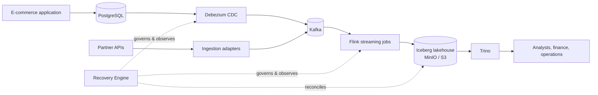
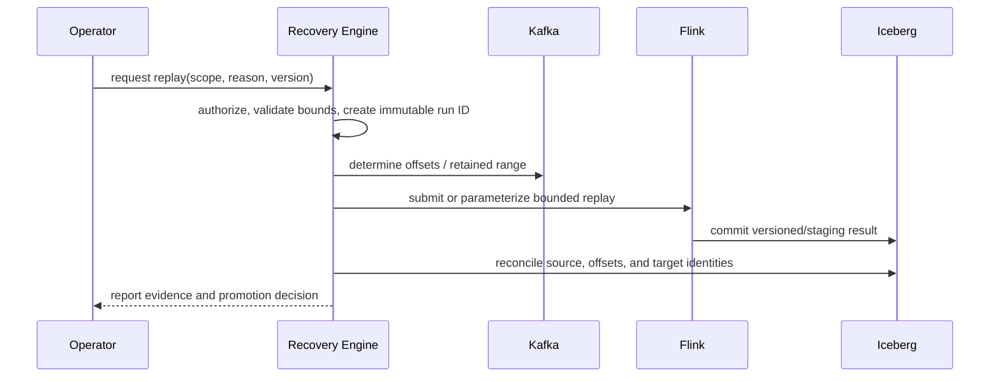

# Architecture

## Purpose

Aether transports transactional e-commerce data from operational systems to trusted analytical data products. Its architectural objective is not merely low-latency movement: it must offer evidence that a result can be traced, reconciled, and safely recovered after faults.

## Context

## Components and responsibilities

| Component | Responsibility | Does not own |
|---|---|---|
| PostgreSQL | System-of-record transactions and write-ahead log | Analytical transformations or replay decisions |
| Debezium | Converts committed WAL changes into source-aware Kafka events | Business enrichment or delivery to the lakehouse |
| API ingestion | Fetches external data using cursors/idempotency keys and emits the common event envelope | CDC semantics for PostgreSQL |
| Kafka | Durable, partitioned event transport and replayable retention window | Global ordering or business deduplication |
| Flink | Stateful validation, enrichment, deduplication, event-time handling, and checkpointed processing | Long-term raw archival or operator policy |
| Iceberg + MinIO/S3 | Versioned durable tables, snapshots, schema evolution, time travel, and object storage | Low-latency operational source of truth |
| Trino + dbt | Query serving, modeled data products, and data tests | Streaming recovery |
| Recovery Engine | Replay workflow, incident/audit history, reconciliation orchestration, and control-plane policy | Inline transformation or a hard dependency on the data path |

## Data plane

The data plane carries records and produces analytical tables:

1. PostgreSQL commits a transaction. Debezium reads the WAL and emits a change event that includes database, table, transaction/source position, operation, and schema information.
2. API adapters emit equivalent envelope metadata where possible, including an upstream cursor and deterministic record identity.
3. Kafka stores events in topic partitions. Ordering is guaranteed only within the selected partition key; order-sensitive entities must use a stable key such as `order_id`.
4. Flink validates the contract, assigns event time and watermarks, records lineage, performs stateful transformations, and checkpoints source positions and state.
5. A Flink Iceberg sink publishes committed results so readers see atomically committed table snapshots rather than partial task output.
6. dbt turns curated tables into governed marts; Trino exposes them to consumers.

## Control plane

The Recovery Engine is intentionally separate from the continuous data path. It stores an audit record for operational commands and gathers evidence from Kafka offsets, Flink checkpoints, Iceberg snapshots, and reconciliation results. It can submit scoped replay work, but it must not synchronously gate normal event processing.

## Event and lineage contract

Every data-plane event will carry, at a minimum:

- `event_id`: stable logical identity used for deduplication and reconciliation;
- `event_type` and `schema_version`: contract routing and evolution;
- `occurred_at` and `ingested_at`: event-time and processing-time observability;
- `source`: system, entity/table, connector/API identity, and source position or cursor;
- `correlation_id`: traceability across related business actions;
- payload plus a change operation when the source is CDC.

Curated Iceberg rows retain enough provenance to connect a business output to the event ID, transformation version, Flink job/checkpoint, and Iceberg snapshot.

## Delivery and correctness guarantees

| Boundary | Baseline guarantee | How Aether makes it safe | Important limit |
|---|---|---|---|
| PostgreSQL → Debezium → Kafka | Committed source changes are captured and delivered at least once across failures. | Persist source positions; monitor connector health; preserve source metadata. | Connector setup, WAL retention, and Kafka retention define recovery limits. |
| Kafka → Flink state | At-least-once without checkpoints; effectively once for state recovery when offsets and state are checkpointed together. | Restore from successful checkpoints; key state by stable business identity. | End-to-end exactly-once still depends on sink behavior and configuration. |
| Flink → Iceberg | Atomic table visibility when checkpoint-integrated commits succeed. | Commit only completed checkpoint results; retain snapshot and job metadata. | Object-store consistency/configuration and connector support matter. |
| Replay → analytical result | Controlled, auditable, bounded reprocessing. | Deterministic IDs, versioned targets, reconciliation, explicit promotion. | Replays can duplicate physical work; logical correctness requires idempotent merge/identity logic. |

The project uses the term **exactly-once result** only when an end-to-end implementation and failure test demonstrate it for a specific path. Kafka delivery alone is not enough.

## Fault model and recovery strategy

| Failure | Expected response | Evidence retained |
|---|---|---|
| Flink task/process loss | Restart and restore from last successful checkpoint. | Checkpoint ID, source offsets, restart event, post-recovery reconciliation. |
| Debezium connector interruption | Resume from persisted offset; alert on lag and WAL-retention risk. | Connector offset, lag, outage interval, source position. |
| Malformed event | Quarantine/DLQ with reason while independent valid records continue. | Event ID, contract version, validation error, quarantine location. |
| Iceberg commit failure | Fail/rollback the incomplete checkpoint and retry through supported sink semantics. | Job attempt, commit error, snapshot status. |
| Wrong transformation/business rule | Run approved bounded replay into a versioned/staging target; reconcile and promote. | Replay run ID, code/version, range, operator, comparison report. |
| Control-plane outage | Continue data processing; buffer/degrade operational observation explicitly. | Service health event and later backfill of audit/reconciliation work. |

## Reconciliation model

Reconciliation is not a single count check. For a defined time window and source scope, it compares:

1. **Completeness:** source/CDC/Kafka/Iceberg counts and watermark coverage.
2. **Identity:** distinct `event_id` sets or a scalable digest/partitioned comparison.
3. **Uniqueness:** duplicate logical IDs in outputs where one is required.
4. **Timeliness:** lag from commit/event time to the materialized table.
5. **Semantic checks:** domain rules such as valid order/payment status transitions and non-negative inventory.

A mismatch produces an incident record, not an automatic destructive repair. The operator chooses a safe action using the retained evidence.

## Security and data handling

- Local demos use synthetic data; secrets enter through environment variables or a future secret manager, never Git.
- Least-privilege service identities and encryption in transit/at rest are target deployment requirements.
- Access to replay, raw archives, and audit records is role-based and logged.
- PII classification, retention, and deletion workflows will be explicitly designed before real personal data is accepted.

## Key trade-offs

| Decision | Benefit | Cost / mitigation |
|---|---|---|
| Kafka rather than direct database-to-lake writes | Decoupling, backpressure handling, replay window | Extra operational surface; local stack remains Docker-based and observable. |
| Flink stateful processing | Event time, state, fault recovery | More complex runtime; checkpoint tests become mandatory. |
| Iceberg lakehouse | Atomic snapshots and evolution | Catalog/object-store coordination; validate with integration tests. |
| Separate control plane | Safer, auditable recovery and resilient data path | Two operational surfaces; define clear contracts and degradation behavior. |
| At-least-once transport plus idempotency | Practical recovery model | Requires rigorous event identities and reconciliation rather than hand-waving exactly-once. |

## Evolution path

1. **Foundation:** local Docker stack, synthetic source generator, first CDC topic, contract fixtures.
2. **Streaming vertical slice:** one Flink job to Iceberg, checkpoints, observability, and failure test.
3. **Lakehouse and serving:** catalog, Trino, dbt models/tests, raw archive.
4. **Reliability control plane:** reconciliation store/API, scoped replay workflow, audit trail.
5. **Production engineering:** CI/CD, monitoring, security hardening, performance benchmarks, and optional Kubernetes/Terraform deployment.
