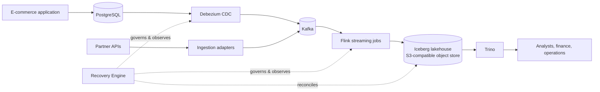
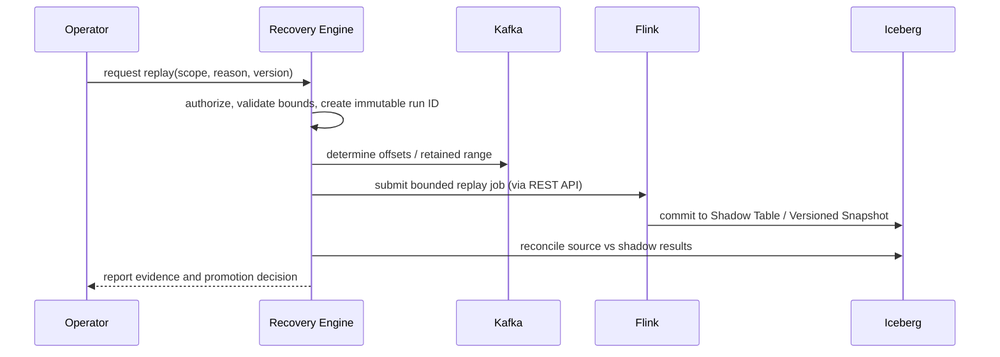

# Architecture

## Purpose

Aether transports transactional e-commerce data from operational systems to trusted analytical data products. Its architectural objective is not merely low-latency movement: it must offer evidence that a result can be traced, reconciled, and safely recovered after faults.

## Context

## Components and responsibilities

| Component | Responsibility | Does not own |
|---|---|---|
| PostgreSQL | System-of-record transactions and write-ahead log | Analytical transformations or replay decisions |
| Debezium | Converts committed WAL changes into source-aware Kafka events | Business enrichment or delivery to the lakehouse |
| API ingestion | Fetches external data using cursors/idempotency keys and emits the common event envelope | CDC semantics for PostgreSQL |
| Kafka | Durable, partitioned event transport and replayable retention window | Global ordering or business deduplication |
| Flink | Stateful validation, enrichment, deduplication, event-time handling, and checkpointed processing | Long-term raw archival or operator policy |
| Iceberg + S3-compatible object store | Versioned durable tables, snapshots, schema evolution, time travel, and object storage | Low-latency operational source of truth |
| Trino + dbt | Query serving, modeled data products, and data tests | Streaming recovery |
| Recovery Engine | Replay workflow, incident/audit history, reconciliation orchestration, and control-plane policy | Inline transformation or a hard dependency on the data path |

## Data plane

The data plane carries records and produces analytical tables:

1. **Ingestion**: PostgreSQL commits a transaction. Debezium reads the WAL and emits a change event. API adapters emit equivalent envelopes. All events are routed to Kafka using a **stable business key** (e.g., `order_id`) to ensure partition-level ordering.
2. **Contract Validation**: Flink consumes events and validates them against a **Schema Registry** (e.g., Confluent or Apicurio). Events violating the contract are routed to a **Dead Letter Queue (DLQ)** to prevent pipeline stalls.
3. **Stateful Processing**: Flink applies windowed aggregations and joins using **RocksDB state backend**. It handles late arrivals via a defined **Watermark strategy** (bounded-out-of-orderness), routing extremely late events to a side-output for reconciliation.
4. **Atomic Sink**: The Flink Iceberg Sink implements a **Two-Phase Commit (2PC)** protocol. 
    - *Pre-commit*: Flink writes data files to S3 during the checkpoint interval.
    - *Commit*: Only upon successful Flink checkpoint completion does the sink commit a new snapshot to the Iceberg Catalog. 
    - *Result*: Trino readers see only atomically committed snapshots, ensuring no partial data from failed jobs is ever visible.
5. **Analytical Layer**: dbt transforms curated Iceberg tables into governed marts; Trino exposes these via a high-performance SQL interface.

## Control plane

The Recovery Engine is a standalone service that manages the "reliability lifecycle." It uses its own metadata store (PostgreSQL) to track the state of the data plane without being in the critical path of event processing.

### Internal Architecture
- **Audit Store**: Records every operator command, replay request, and incident.
- **Observability Bridge**: Polls Flink JobManager for checkpoint IDs and Kafka for consumer group offsets.
- **Replay Orchestrator**: Interfaces with Flink's REST API to trigger bounded replay jobs (via Savepoints or specific offset ranges).

## Event and lineage contract

Every data-plane event must adhere to a strict envelope:

- `event_id`: UUID or deterministic hash for deduplication.
- `event_type` and `schema_version`: For contract routing and evolution.
- `occurred_at` (Event Time) and `ingested_at` (Processing Time).
- `source`: `{system: string, entity: string, position: string}`.
- `correlation_id`: For cross-service traceability.

**Lineage Persistence**: Every row in the final Iceberg table retains `_flink_checkpoint_id` and `_event_id`, allowing a direct trace from a business metric back to the raw Kafka event and the specific Flink job state that produced it.

## Delivery and correctness guarantees

| Boundary | Guarantee | Mechanism | Limit |
|---|---|---|---|
| PG $\rightarrow$ Kafka | At-least-once | WAL offsets $\rightarrow$ Kafka producer ACKs | WAL retention period |
| Kafka $\rightarrow$ Flink | Effectively-once | Checkpointed offsets + RocksDB state | State size $\rightarrow$ Checkpoint duration |
| Flink $\rightarrow$ Iceberg | Exactly-once | 2PC Sink $\rightarrow$ Iceberg Snapshot Commit | Catalog availability |
| Replay $\rightarrow$ Result | Idempotent | Deterministic IDs $\rightarrow$ Iceberg `MERGE INTO` | Compute cost of re-processing |

## Fault model and recovery strategy

| Failure | Response | Engineering Detail |
|---|---|---|
| Flink Task Loss | Automatic Restart | Restore from last successful checkpoint in distributed storage. |
| Connector Outage | Offset Resume | Debezium resumes from stored offset; Recovery Engine alerts on lag $> \text{threshold}$. |
| Contract Break | Quarantine | Schema validation $\rightarrow$ DLQ $\rightarrow$ Operator notification. |
| Commit Failure | Rollback | Iceberg's optimistic concurrency control rolls back partial commits. |
| Logic Error | Bounded Replay | Run UC-03 into a Shadow Table $\rightarrow$ Validate $\rightarrow$ Swap. |
| Control Plane Down | Degraded Mode | Data plane continues; audit logs are buffered/backfilled. |

## Reconciliation model

Reconciliation is an active process of proving correctness. It follows a tiered approach:

1. **L1: Lightweight (Metric-based)**:
    - Compares `COUNT(*)` and `MAX(event_time)` between Source $\rightarrow$ Kafka $\rightarrow$ Iceberg for a given time bucket.
2. **L2: Deep (Identity-based)**:
    - Triggered if L1 fails.
    - Uses **partitioned checksums** (hashes of sorted `event_id` sets) to locate specific missing or duplicated records without scanning the full dataset.
3. **L3: Semantic (Business-based)**:
    - Runs dbt tests to ensure domain invariants (e.g., "Payment cannot exist without an Order").

## Key trade-offs

| Decision | Benefit | Cost / Mitigation |
|---|---|---|
| Kafka Backbone | Decoupling, replayability, backpressure | Operational overhead; mitigated by Docker-based local stack. |
| Flink State | True event-time processing, fault recovery | Checkpoint management complexity; mitigated by RocksDB. |
| Iceberg Lakehouse | ACID, time-travel, schema evolution | Catalog coordination; mitigated by using Trino/Flink integrated sinks. |
| Separate Control Plane | Operational safety, auditability | Increased architectural surface; mitigated by strict API contracts. |
| Idempotency over 2PC | Practical recovery, simpler sinks | Requires strict identity management; mitigated by `event_id` enforcement. |

## Evolution path

1. **Foundation**: Local Docker stack $\rightarrow$ synthetic source $\rightarrow$ first CDC topic $\rightarrow$ contract fixtures.
2. **Streaming vertical slice**: Flink $\rightarrow$ Iceberg $\rightarrow$ Checkpoints $\rightarrow$ Failure tests.
3. **Lakehouse and serving**: Catalog $\rightarrow$ Trino $\rightarrow$ dbt models $\rightarrow$ Raw archive.
4. **Reliability control plane**: Reconciliation API $\rightarrow$ Replay workflow $\rightarrow$ Audit trail.
5. **Production engineering**: CI/CD $\rightarrow$ Monitoring $\rightarrow$ Security $\rightarrow$ K8s/Terraform.
